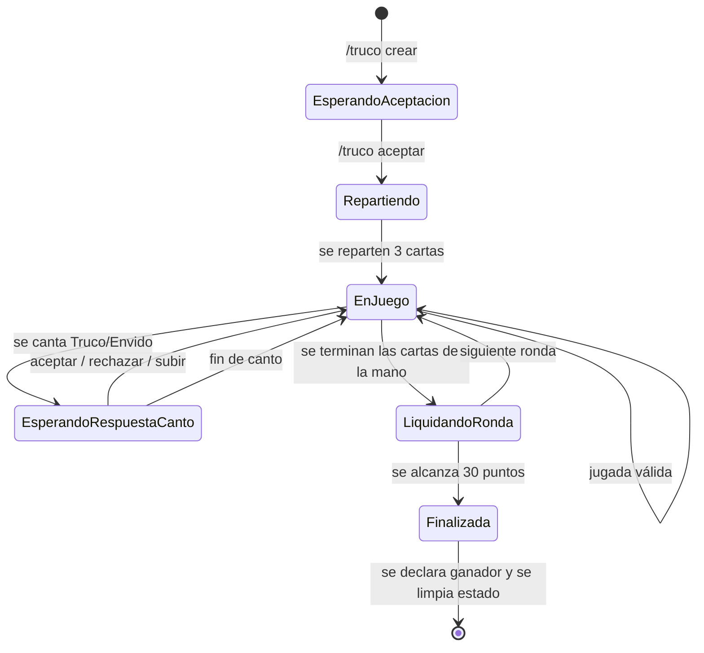

# 🃏 Bot de Truco Argentino — Discord (Rust)

> Árbitro automatizado para partidas de **Truco Argentino 1vs1 por turnos**, desarrollado en Rust para el **Seminario de Rust 2026**.  
> El bot gestiona el flujo completo del juego, valida jugadas y cantos, y asigna puntajes sin alterar el estado ante acciones inválidas.

[](https://www.rust-lang.org/)
[](https://tokio.rs/)
[](https://poise.rs/)
[](https://serenity.rs/)
[](LICENSE)

---

## 📑 Tabla de contenidos

- [Acerca del proyecto](#acerca-del-proyecto)
- [Objetivos](#objetivos)
- [Características](#características)
- [Arquitectura de software](#arquitectura-de-software)
- [Modelo de datos](#modelo-de-datos)
- [Flujo de vida de una partida](#flujo-de-vida-de-una-partida)
- [Stack tecnológico](#stack-tecnológico)
- [Decisiones técnicas clave](#decisiones-técnicas-clave)
- [Instalación](#instalación)
- [Uso](#uso)
- [Pruebas](#pruebas)
- [Roadmap / Cronograma](#roadmap--cronograma)
- [Contribución](#contribución)
- [Licencia](#licencia)
- [Autores](#autores)
- [Referencias](#referencias)

---

## 🎯 Acerca del proyecto

El presente proyecto consiste en el desarrollo de un **bot de Discord programado en Rust** que actúa como árbitro automatizado para partidas de Truco Argentino en modalidad **1vs1 por turnos**.

El bot debe ser capaz de:

1. Recibir intenciones de juego de los usuarios mediante **slash commands** de Discord.
2. Validar que cada jugada respete las reglas del turno y del estado actual de la partida.
3. Procesar cantos (`Truco`, `Retruco`, `Vale Cuatro`, `Envido`, `Real Envido`, `Falta Envido`) y responder con aceptación, rechazo o contraoferta.
4. Llevar el marcador y declarar al ganador de la partida.
5. Mantener el estado de la partida **aislado de la infraestructura de red** (capa de Discord).

### Principio de diseño

Se aplica una **arquitectura de dominio aislado**: el motor de juego (reglas de negocio) se construye y valida de forma totalmente independiente de la librería de red y de la API de Discord. De este modo, si la plataforma de comunicación cambiara en el futuro, la lógica central del árbitro permanecería intacta.

---

## 🎯 Objetivos

### Objetivo general
Construir un motor de juego de Truco Argentino 1vs1 en Rust, expuesto como bot de Discord, que garantice la validez de las jugadas y la consistencia del puntaje bajo un modelo concurrente seguro.

### Objetivos específicos

- [ ] Aplicar herramientas y paradigmas avanzados de Rust (`ownership`, `borrowing`, `lifetimes`, `async/await`).
- [ ] Proveer una arquitectura aislada que separe la lógica de reglas del juego de la capa de comunicaciones de Discord.
- [ ] Garantizar concurrencia entre partidas simultáneas sin carreras de datos ni deadlocks.
- [ ] Implementar pruebas unitarias sobre el motor de juego de forma independiente de Discord.
- [x] Documentar decisiones de diseño y fundamentos técnicos.

---

## ✨ Características

| Característica | Descripción |
|---|---|
| 🎴 **Partidas 1vs1** | Dos jugadores compiten por alcanzar el puntaje objetivo (15 puntos). |
| ⚖️ **Árbitro automático** | Valida jugadas, turnos y asignación de puntajes. |
| 📢 **Cantos válidos** | Truco, Retruco, Vale Cuatro, Envido, Real Envido, Falta Envido. |
| 🔒 **Mano privada** | Las cartas se envían por respuesta efímera; solo el dueño las ve. |
| ⚡ **Concurrencia** | Varias partidas simultáneas en diferentes canales sin bloqueos. |
| 🧱 **Dominio puro** | Las reglas del juego no dependen de Discord ni de Tokio. |

---

## 🏗️ Arquitectura de software

```mermaid
graph TD
    A[Usuario / Discord] -->|Slash Command| B[Poise Framework]
    B -->|Evento| C[Serenity / Discord API]
    C -->|Contexto| D[Servicio de Partidas]
    D -->|Estado compartido| E[Arc<Mutex<Partida>>]
    D -->|Reglas de negocio| F[Motor del Truco - Dominio Puro]
    F -->|Validación / Puntaje| G[Resultado de Jugada]
    G --> D
    D -->|Respuesta pública / efímera| C
    C --> A

    subgraph Capa de Presentación (Discord)
    A
    B
    C
    end

    subgraph Capa de Aplicación
    D
    E
    end

    subgraph Capa de Dominio (Puro)
    F
    G
    end
```

### Capas

| Capa | Responsabilidad | Depende de |
|---|---|---|
| **Presentación** | Slash commands, respuestas públicas/efímeras, eventos de Discord | Poise, Serenity |
| **Aplicación** | Orquestación de partidas, estado compartido (`Arc<Mutex<>>`) | Tokio |
| **Dominio** | Reglas del Truco, validación de jugadas, cálculo de puntaje | Ninguna (lógica pura de Rust) |

---

## 📦 Modelo de datos

### Entidades principales

```text
Jugador
  - id: UserId
  - nombre: String
  - puntos: u8
  - mano: Vec<Carta>

Carta
  - palo: Palo   (Espada, Basto, Copa, Oro)
  - numero: Numero (1..=12)

Partida
  - id: ChannelId            ← clave del repositorio (canal, no usuario)
  - jugadores: [Jugador; 2]
  - estado: EstadoPartida    (Esperando, EnJuego, Finalizada)
  - turno_actual: UserId
  - envido_cantado: bool
  - truco_nivel: NivelTruco  (Ninguno, Truco, Retruco, ValeCuatro)
  - puntaje: [u8; 2]
  - ganador: Option<UserId>
```

### Relaciones

- Una `Partida` tiene exactamente dos `Jugador`.
- Cada `Jugador` tiene una `Mano` de 3 cartas.
- El estado (`EstadoPartida`) transita según jugadas y cantos válidos.

> **[PENDIENTE]:** Definir los `structs` en Rust con los traits y métodos necesarios para el desarollo.

---

## 🔄 Flujo de vida de una partida



**Secuencia resumida:**

1. **Creación:** un usuario invoca `/truco crear` en un canal; se inicializa una `Partida` con `channel_id` como clave.
2. **Aceptación:** el oponente invoca `/truco aceptar`; se reparten 3 cartas a cada jugador (mano enviada por mensaje efímero).
3. **Jugadas por turno:** cada jugador juega una carta cuando es su turno; el árbitro valida pertenencia y turno.
4. **Cantos:** en cualquier momento se puede cantar Truco/Retruco/Vale Cuatro o Envido; el oponente responde aceptar/rechazar/subir.
5. **Liquidación de ronda:** se determina quién gana la mano según las reglas del Truco; se actualizan puntos.
6. **Fin de partida:** se alcanza el puntaje objetivo; se declara ganador y se limpia el estado del canal.

> **[PENDIENTE]:** Insertar diagrama de flujo funcional (usuario → bot) y red de Petri para el desarrollo de partidas.

---

## 🛠️ Stack tecnológico

| Herramienta / Crate | Propósito |
|---|---|
| [Rust](https://www.rust-lang.org/) | Lenguaje de programación |
| [Tokio](https://tokio.rs/) | Runtime asíncrono basado en eventos |
| [Poise](https://poise.rs/) | Framework de comandos de Discord sobre Serenity |
| [Serenity](https://serenity.rs/) | Cliente de bajo nivel de la API de Discord |
| [Serde](https://serde.rs/) | Serialización / deserialización |
| [Clippy](https://rust-lang.github.io/rust-clippy/) | Linting de Rust |
| Cargo | Gestor de paquetes, compilación y pruebas |

---

## ❓ Decisiones técnicas clave

A continuación se responden las preguntas de diseño del borrador original:

### ¿Por qué Rust?
Seguridad de memoria en tiempo de compilación (sin GC), concurrencia sin miedo (`fearless concurrency`) y rendimiento nativo vía LLVM.

### ¿Por qué Discord como medio principal?
API de interacciones (Slash Commands) robusta, autenticación nativa de usuarios, respuestas públicas y efímeras, y amplio ecosistema en Rust.

### ¿Qué responsabilidad cumplen `#[tokio::main]`, `async fn` y `#[poise::command]`?

| Elemento | Responsabilidad |
|---|---|
| `#[tokio::main]` | Punto de entrada que inicia el runtime de Tokio. |
| `async fn` | Declara una función asíncrona que retorna un `Future`. |
| `#[poise::command]` | Registra un slash command y conecta la interacción de Discord con el handler. |

**Ciclo de una interacción:** usuario invoca comando → Discord envía interacción → Serenity recibe el evento → Poise dispacha al `async fn` → el handler accede al estado compartido y responde → Discord entrega la respuesta.

### ¿Qué son `Arc`, `Mutex` y `RwLock`?
- `Arc<T>`: puntero compartido con conteo atómico de referencias (propiedad compartida entre tareas).
- `Mutex<T>`: exclusión mutua; solo una tarea accede a `T` a la vez.
- `RwLock<T>`: múltiples lectores concurrentes o un solo escritor.

### ¿Por qué el estado compartido necesita `Arc` y `Mutex`?
El estado del bot es accesible desde múltiples tareas de Tokio concurrentes. `Arc` permite compartir la propiedad; `Mutex` garantiza que solo una tarea mute el estado a la vez, evitando carreras de datos.

### ¿Por qué es incorrecto mantener un `MutexGuard` vivo durante un `.await`?
El `MutexGuard` mantiene el bloqueo mientras está vivo. Si se hace `.await` dentro de su scope, el hilo cede el control **todavía sosteniendo el lock**, bloqueando a otras tareas y provocando deadlocks o pérdida de concurrencia.  
**Solución:** liberar el guard antes del `.await` (bloque `{ }` o `drop(guard)`).

```rust
// ❌ Incorrecto
let guard = estado.lock().await;
ctx.reply("hola").await; // se mantiene el lock durante el await

// ✅ Correcto
{
    let guard = estado.lock().await;
    // usar datos protegidos
} // guard se libera aquí
ctx.reply("hola").await;
```

### ¿Por qué `/truco mano` debe usar respuesta efímera?
Para no exponer las cartas del jugador a otros participantes del canal. Poise distingue respuestas públicas (`ephemeral: false`) de efímeras (`ephemeral: true`).

### ¿Por qué la clave del repositorio de juego es el canal y no el usuario?
Una partida ocurre en un canal específico. Dos usuarios pueden jugar en canales distintos simultáneamente, y un mismo usuario puede tener partidas activas en varios canales. Por tanto, `channel_id` es la clave correcta.

### ¿Cómo se realizan las pruebas unitarias?
- **Motor de juego:** pruebas con `#[cfg(test)]` que instancian `Partida`, aplican jugadas y verifican estados, sin red ni Discord.
- **Integración:** flujo completo de una partida simulada con mocks del contexto de Poise.
- **Concurrencia:** múltiples tareas ejecutando partidas simultáneas y verificando ausencia de data races.

---

## 🚀 Instalación

### Prerrequisitos
- [Rust toolchain](https://rustup.rs/) (1.85 o superior)
- Cuenta de Discord y una aplicación en el [Discord Developer Portal](https://discord.com/developers/applications)
- Token del bot y ID de la aplicación

### Pasos

```bash
# 1. Clonar el repositorio
git clone https://github.com/TU-USUARIO/bot-truco-rust.git
cd bot-truco-rust

# 2. Configurar variables de entorno
cp .env.example .env
# Editar .env con un DISCORD_TOKEN y APPLICATION_ID 

# 3. Compilar
cargo build --release

# 4. Ejecutar
cargo run
```

---

## 🎮 Uso

El bot se controla mediante **slash commands** en Discord:

| Comando | Descripción | Visibilidad |
|---|---|---|
| `/truco crear` | Inicia una nueva partida en el canal | Pública |
| `/truco aceptar` | Acepta la invitación a jugar | Pública |
| `/truco jugar <carta>` | Juega una carta en tu turno | Pública |
| `/truco mano` | Muestra tus cartas (solo tú las ves) | **Efímera** |
| `/truco truco` | Canta Truco | Pública |
| `/truco envido` | Canta Envido | Pública |
| `/truco puntaje` | Muestra el marcador actual | Pública |

> **[PENDIENTE]:** Registrar los comandos en la API de Discord (`/commands` globales o de guild) al iniciar el bot.

---

## 🧪 Pruebas

```bash
# Ejecutar todas las pruebas unitarias del motor
cargo test

# Ejecutar pruebas con salida detallada
cargo test -- --nocapture

# Verificar lints con Clippy
cargo clippy -- -D warnings
```

**Estrategia de pruebas:**

| Tipo | Alcance |
|---|---|
| Unitarias | Validar reglas, jugadas, cantos y puntaje del motor de dominio |
| Integración | Flujo completo de una partida simulada |
| Concurrencia | Varias partidas simultáneas sin data races |

---

## 🗺️ Roadmap / Cronograma

| Hito | Descripción | Estado |
|---|---|---|
| H0 | Documentación y presentación | - En proceso |
| H1 | Motor de dominio (reglas, validación, puntaje) | - |
| H2 | Adaptador Discord (Poise + Serenity) | - |
| H3 | Pruebas unitarias e integración | - |
| H4 | Integración final y despliegue del bot | - |

### Trabajos futuros
- [ ] Soporte para partidas en parejas (2vs2).
- [ ] Sistema de ranking y estadísticas por usuario.
- [ ] Componentes interactivos de Discord (botones, menús).
- [ ] Persistencia de partidas en base de datos.

---

## 🤝 Contribución

1. Fork el repositorio.
2. Crea una rama para tu característica (`git checkout -b feature/nombre`).
3. Commit tus cambios (`git commit -m 'feat: agregar algo'`).
4. Push a la rama (`git push origin feature/nombre`).
5. Abre un Pull Request.

---

## 📄 Licencia

Este proyecto está bajo la Licencia MIT. Ver el archivo `LICENSE` para más detalles.

---

## 👥 Autores

- **Ezequiel**
- **Teo Vázquez**
- **Mateo Cocimano**

*Proyecto final — Seminario de Rust 2026*

---

## 📚 Referencias

- [El libro de Rust (español)](https://book.rustlang-es.org/)
- [Tokio documentation](https://docs.rs/tokio/latest/tokio/)
- [Poise - Rust](https://poise.rs/)
- [Serenity](https://serenity.rs/)

---

> 💡 **Nota:** Este documento es un README base para GitHub. Las secciones marcadas como **[PENDIENTE]** y los datos del cronograma deberan completarse manualmente con la información específica antes de la entrega final.